# DAM405 PA3 — From AutoML to a Monitored, Explainable Model

**Module:** DAM405 · **Assignment:** Programming Assignment 3
**Author:** _&lt;your name&gt;_ · **Student ID:** _&lt;your ID&gt;_ · **Date:** 19 October 2026

---

## Contents

1. [Overview](#1-overview)
2. [Architecture](#2-architecture)
3. [Environment and reproducibility](#3-environment-and-reproducibility)
4. [Data](#4-data)
5. [Baseline model and experiment tracking](#5-baseline-model-and-experiment-tracking)
6. [AutoML with FLAML](#6-automl-with-flaml)
7. [Results: baseline vs AutoML](#7-results-baseline-vs-automl)
8. [Model registry](#8-model-registry)
9. [Explainability with SHAP](#9-explainability-with-shap)
10. [Serving with FastAPI](#10-serving-with-fastapi)
11. [Monitoring and structured logging](#11-monitoring-and-structured-logging)
12. [Data-drift detection](#12-data-drift-detection)
13. [Testing](#13-testing)
14. [How to run](#14-how-to-run)
15. [Project structure](#15-project-structure)
16. [Limitations and future work](#16-limitations-and-future-work)
17. [References](#17-references)
18. [AI-use declaration](#18-ai-use-declaration)

---

## 1. Overview

This project builds an end-to-end MLOps workflow for a binary classification task. The task is
to predict whether a person earns **more than \$50K a year** (`income = 1`) from the UCI Adult
census data.

The workflow covers the full model lifecycle:

| Stage | What was done | Tooling |
|---|---|---|
| Train | A Logistic Regression **baseline** and an **AutoML** search over five model families | scikit-learn, FLAML |
| Track | Every run's parameters, metrics, plots and model artifacts | MLflow Tracking (SQLite) |
| Register | The best run promoted to the registry as `adult-income-classifier` with alias **`@champion`** | MLflow Model Registry |
| Explain | Global and local explanations of the champion | SHAP |
| Serve | The champion served by a REST API | FastAPI + Uvicorn |
| Observe | Structured JSON logging, request monitoring (count, latency, error rate), live data-drift detection | Python `logging`, SciPy |

**Headline result:** the FLAML AutoML model (**XGBoost**) reached a test **ROC-AUC of 0.929**,
against **0.904** for the baseline, and test **F1 rose from 0.655 to 0.712**. It was registered as
the champion and serves predictions at about **5 ms median latency**. The drift detector
correctly stayed quiet on normal traffic and flagged drift on deliberately shifted traffic.

All settings (paths, seeds, split sizes, time budget, drift thresholds, ports) live in a
single file, [`config/config.yaml`](config/config.yaml). Nothing is hard-coded.

---

## 2. Architecture

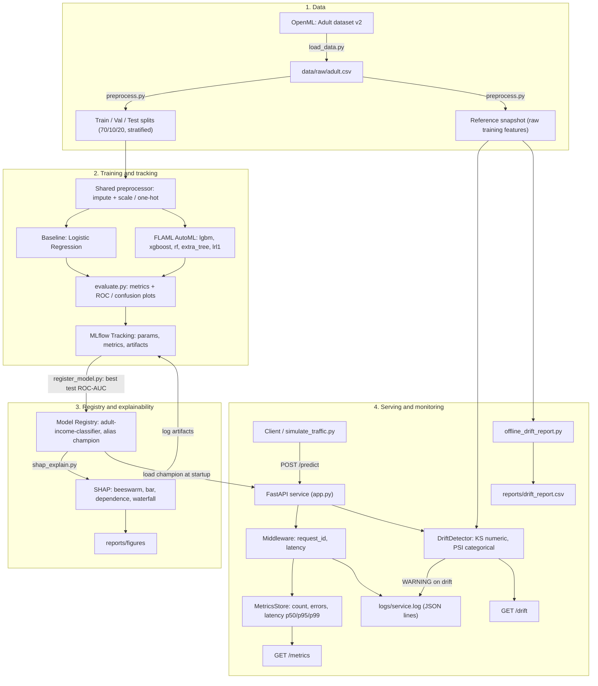

| Stage | Module | Output |
|---|---|---|
| Ingest | `src/data/load_data.py` | `data/raw/adult.csv` |
| Split + reference | `src/data/preprocess.py` | `data/processed/*.parquet`, `data/reference/reference.parquet` |
| Evaluate | `src/training/evaluate.py` | metrics dict, confusion-matrix + ROC PNGs |
| Baseline | `src/training/train_baseline.py` | MLflow run `baseline_logreg` |
| AutoML | `src/training/train_automl.py` | MLflow run `automl_flaml` + search-history CSV |
| Registry | `src/training/register_model.py` | `adult-income-classifier@champion` |
| Explain | `src/explain/shap_explain.py` | `reports/figures/shap_*.png`, artifacts on the champion run |
| Serve | `src/serving/app.py`, `schemas.py`, `model_loader.py` | `/health`, `/predict`, `/metrics`, `/drift` |
| Monitor | `src/serving/monitoring.py`, `drift.py` | `logs/service.log`, endpoint JSON |
| Offline drift | `scripts/offline_drift_report.py` | `reports/drift_report.csv`, `drift_histograms.png` |

---

## 3. Environment and reproducibility

The project targets **Python 3.11.14** in a virtual environment (`.venv`, created with `uv`).
Every dependency is pinned to an exact version in [`requirements.txt`](requirements.txt), so the
environment can be rebuilt identically. The fixed random seed is `42`.

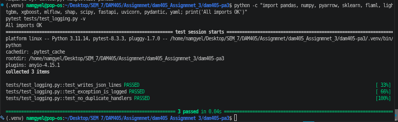
*Figure 1. All packages import successfully inside the `.venv`, and the structured-logging tests pass (3/3).*

**Deliberate version pins.** Several pins were chosen to resolve real conflicts during setup.
They are recorded here because they are environment decisions, a core MLOps concern:

| Pin | Reason |
|---|---|
| `xgboost==1.7.6` | xgboost 2.x on Linux pulls a ~335 MB `nvidia-nccl-cu12` GPU wheel, which timed out on a slow network. 1.7.6 is CPU-only and still satisfies FLAML's `xgboost<3` requirement. The exact pin stops the resolver from choosing 2.x. |
| `numpy==1.26.4` | xgboost 1.7.6 predates numpy 2.0, and numba (pulled in by SHAP) is strict about numpy versions. |
| `scikit-learn==1.5.2` | scikit-learn 1.6 changed how estimator tags work, which breaks older xgboost. |
| `sqlalchemy==2.0.36` | MLflow 2.17 allows any `sqlalchemy<3`, but SQLAlchemy 2.1 removed a class MLflow imports, which crashed the tracking store. Pinning this transitive dependency fixed it. |

---

## 4. Data

The **UCI Adult** dataset (OpenML `adult`, version 2) has **48,842 rows** and 14 features plus
the target:

- **6 numeric:** age, fnlwgt, education-num, capital-gain, capital-loss, hours-per-week.
- **8 categorical:** workclass, education, marital-status, occupation, relationship, race, sex,
  native-country.

The loader strips whitespace, converts `?` to missing values and maps the target to 0/1.

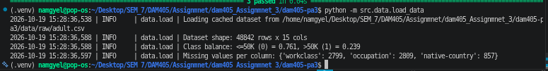
*Figure 2. Dataset shape, class balance and missing values.*

Two properties shape the rest of the project:

- **Class imbalance (76% `<=50K`, 24% `>50K`).** A model that always predicts `<=50K` would
  already be 76% accurate. Models are therefore compared on **ROC-AUC** and **F1**, not accuracy.
- **Missing values** in `workclass` (2,799), `occupation` (2,809) and `native-country` (857).

**Splitting and preprocessing.** The data is split **70 / 10 / 20** into train / validation /
test, **stratified** on the target. The test set is used only for the final evaluation. A single
shared `ColumnTransformer` is used by both models:

- **Numeric:** median imputation, then standardisation.
- **Categorical:** most-frequent imputation, then one-hot encoding with
  `handle_unknown="ignore"`, so unseen categories at serving time don't crash the API.

The transformer is fitted on the training split only, which prevents information leaking from
validation or test data. The raw training features are also saved as
`data/reference/reference.parquet`, the baseline for drift detection.

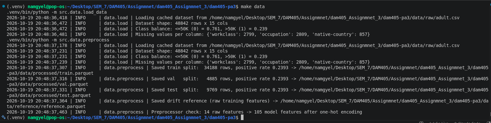
*Figure 3. Train 34,188 / val 4,885 / test 9,769 rows. The identical positive rate (0.2393) in every split confirms the stratification worked. One-hot encoding expands the 14 raw features to 105 model features.*

---

## 5. Baseline model and experiment tracking

The baseline is a **Logistic Regression** (`C=1.0`, `max_iter=1000`) inside a scikit-learn
`Pipeline` with the shared preprocessor. All runs are tracked in **MLflow** with a SQLite
backend (`mlflow.db`) and a local artifact store (`mlartifacts/`), in the experiment
`dam405-pa3-adult-income`. Each run logs:

- **Parameters:** hyperparameters, seed, split sizes, feature lists.
- **Metrics:** accuracy, precision, recall, F1, ROC-AUC and log-loss, on both validation and test.
- **Tags:** `model_type`, `stage`, `dataset`.
- **Artifacts:** confusion-matrix and ROC plots, plus the fitted pipeline as an MLflow model,
  with an input **signature** and an **input example**.

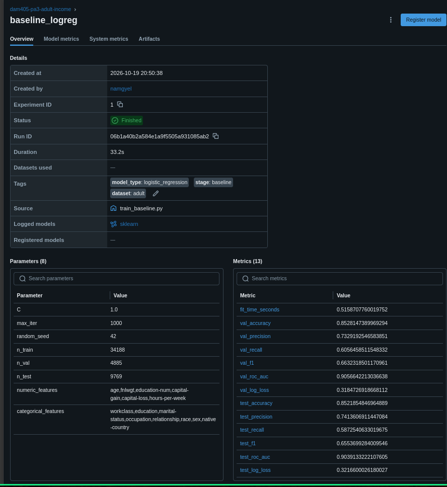
*Figure 4. MLflow run `baseline_logreg`: tags, the 8 logged parameters and 13 metrics (test ROC-AUC 0.9039).*

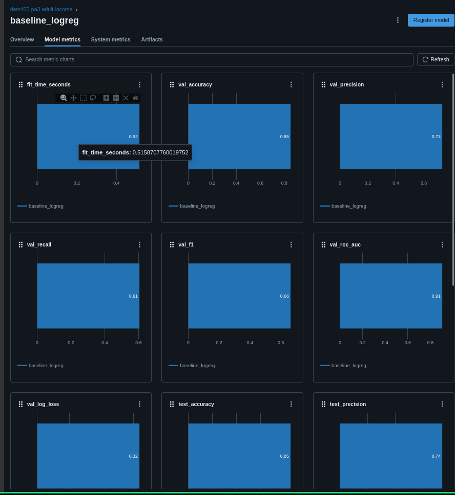
*Figure 5. The Model metrics tab charts each logged metric.*

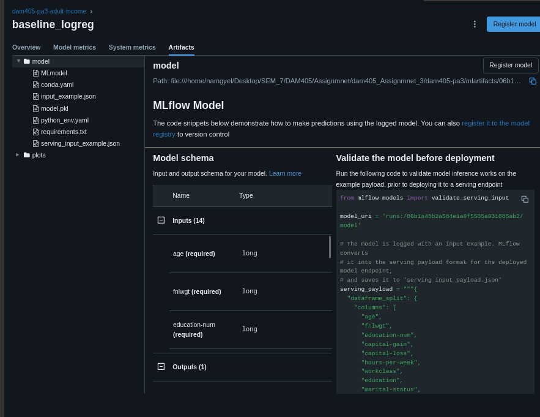
*Figure 6. Artifacts: the logged `model/` (MLmodel, model.pkl, conda.yaml, requirements.txt, input example) with its inferred input schema, plus `plots/`.*

---

## 6. AutoML with FLAML

**FLAML** searched five model families (LightGBM, XGBoost, Random Forest, Extra Trees and
L1-regularised Logistic Regression) for a **180-second budget**, optimising **validation
ROC-AUC** with a hold-out validation set. To keep the comparison fair, FLAML searched on the
output of the *same* fitted preprocessor. The winning estimator was then wrapped with that
preprocessor into a single scikit-learn `Pipeline`, so it accepts raw rows exactly like the
baseline.

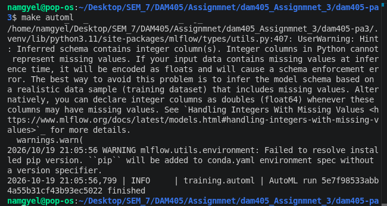
*Figure 7. `make automl` completing and logging the AutoML run to MLflow. FLAML's full trial log is stored as the `flaml/flaml.log` artifact.*

**Search outcome.** The best model was **XGBoost**, found at iteration 65 after **24.7 s** of
the 180 s budget, with validation ROC-AUC **0.9323** (FLAML's "best loss"
= 1 − ROC-AUC = 0.0677). The search history shows LightGBM improving quickly at first, then
XGBoost overtaking it:

| Time (s) | Learner | Validation ROC-AUC |
|---|---|---|
| 0.1 | lgbm | 0.8584 |
| 2.3 | lgbm | 0.9304 |
| 10.3 | xgboost | 0.9307 |
| 13.6 | xgboost | 0.9315 |
| **24.7** | **xgboost** | **0.9323** |

Best configuration: `n_estimators=2560`, `max_leaves=4`, `learning_rate≈0.060`,
`subsample≈0.96`, `colsample_bytree≈0.99`, `reg_alpha≈0.006`, `reg_lambda≈0.097`. That means many
shallow trees with a small learning rate, a typical well-regularised boosting setup.

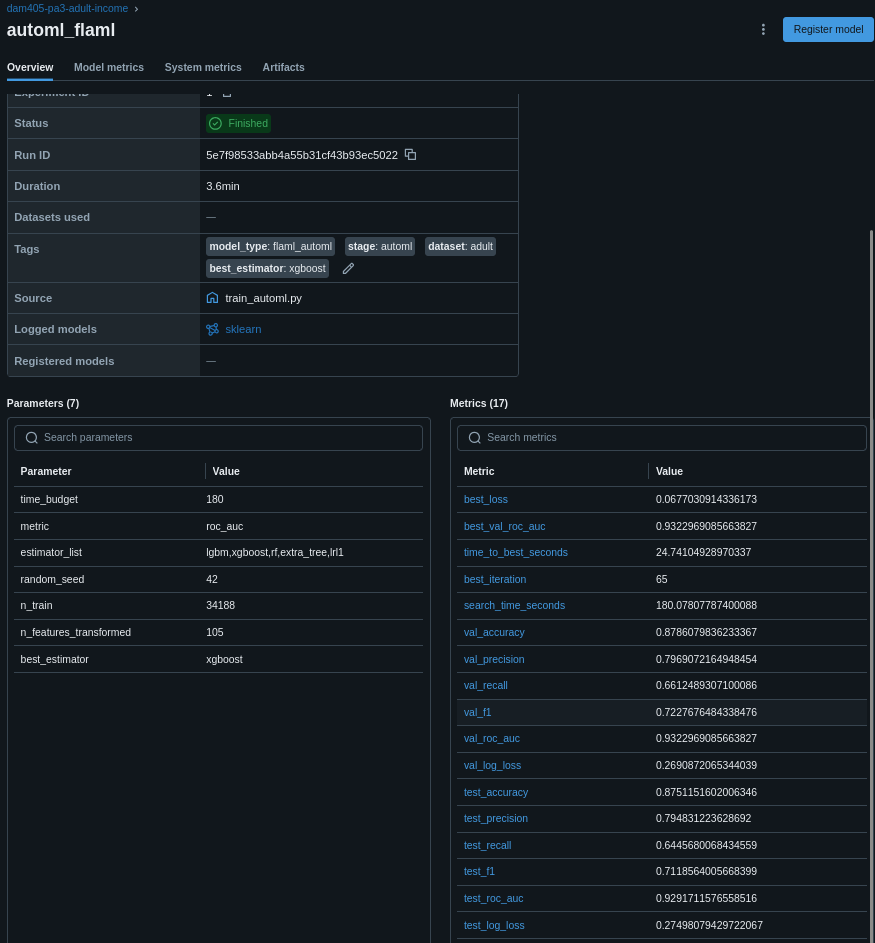
*Figure 8. MLflow run `automl_flaml`: search parameters, `best_estimator = xgboost`, the search metrics (`best_loss`, `time_to_best_seconds`, `best_iteration`) and val/test metrics.*

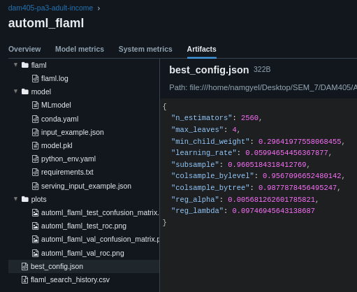
*Figure 9. AutoML artifacts: `best_config.json`, `flaml_search_history.csv`, the FLAML log, the model and the evaluation plots.*

---

## 7. Results: baseline vs AutoML

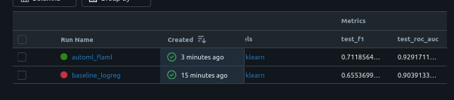
*Figure 10. Both runs in the experiment, with test F1 and test ROC-AUC columns.*

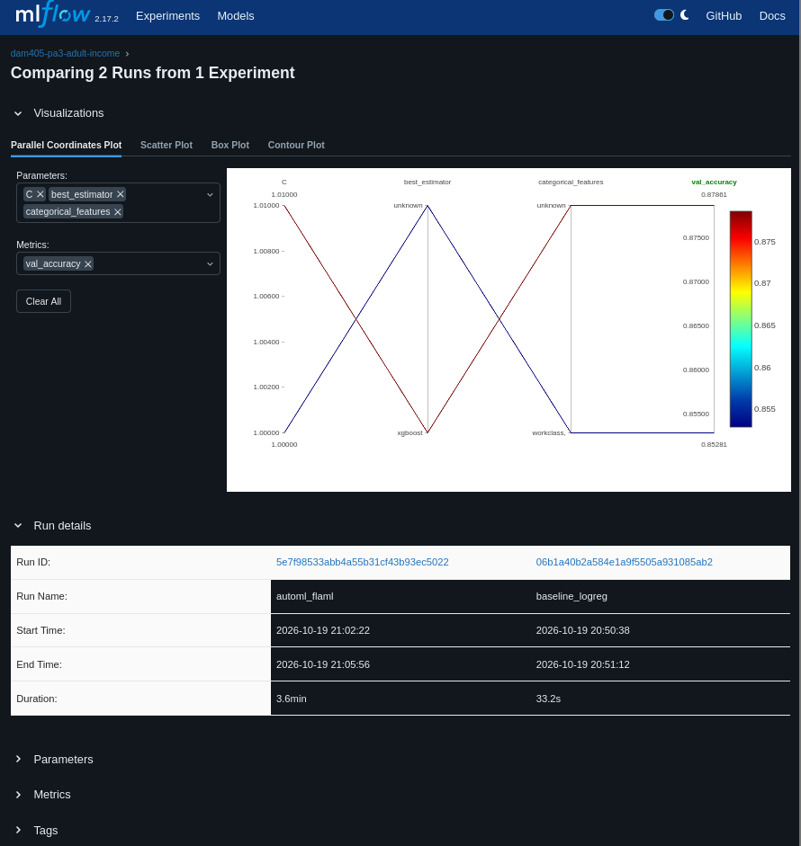
*Figure 11. MLflow's compare view of the two runs.*

**Test-set results** (9,769 rows, never seen during training or model selection):

| Metric | Logistic Regression (baseline) | FLAML → XGBoost | Change |
|---|---|---|---|
| **ROC-AUC** | 0.9039 | **0.9292** | +0.025 |
| **F1** | 0.6554 | **0.7119** | +0.057 |
| Accuracy | 0.8522 | **0.8751** | +0.023 |
| Precision | 0.7414 | **0.7948** | +0.053 |
| Recall | 0.5873 | **0.6446** | +0.057 |
| Log-loss (lower is better) | 0.3217 | **0.2750** | −0.047 |
| Training time | 0.5 s | 180 s search | |

<table>
<tr>
<td>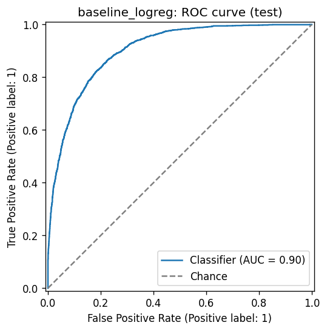<br><em>Baseline: test ROC curve</em></td>
<td>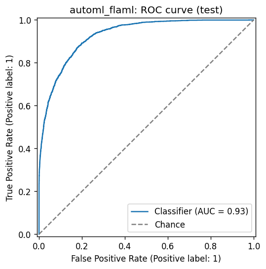<br><em>AutoML (XGBoost): test ROC curve</em></td>
</tr>
<tr>
<td>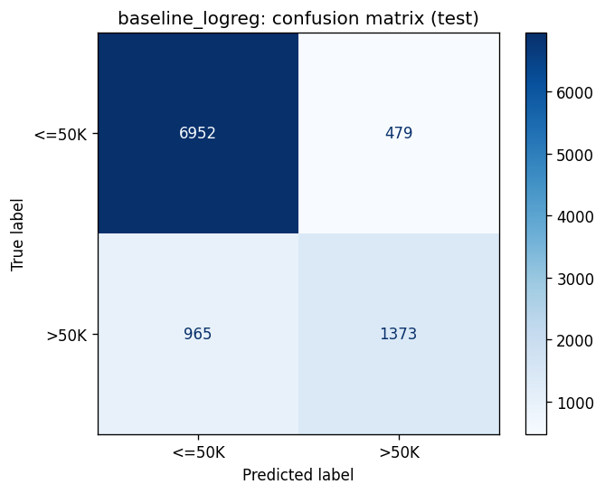<br><em>Baseline: test confusion matrix</em></td>
<td><br><em>AutoML (XGBoost): test confusion matrix</em></td>
</tr>
</table>

**Discussion.** The AutoML model is better on **every** metric. The gain is largest for recall
and F1: it finds more of the minority `>50K` class without losing precision. Gradient-boosted
trees can capture non-linear effects (such as the inverted-U shape of age, Section 9) and
interactions that a linear model cannot.

Two points keep the comparison honest:
- **The baseline is already strong** (ROC-AUC 0.904), so AutoML's improvement is clear but modest.
- **The cost is higher**: 180 s of search versus 0.5 s of training, and a less interpretable
  model. That is why SHAP explanations are added in Section 9.

Both models still have recall well below precision at the default 0.5 threshold. They miss
more high earners than they wrongly flag (see Limitations).

---

## 8. Model registry

`register_model.py` queries all runs in the experiment, ranks them by **test ROC-AUC**, and
registers the best one:

- **Name:** `adult-income-classifier`, **version 1**.
- **Source run:** `automl_flaml`, test ROC-AUC 0.9292.
- **Alias:** **`@champion`**.
- **Description:** which run was selected, by which metric, and on which date.
- **Tags:** `model_type`, `best_estimator`, `test_roc_auc`, `source_run_name`.

The API loads `models:/adult-income-classifier@champion`, not a run ID or a file path. To
promote a better model later, you only move the alias; the serving code doesn't change.

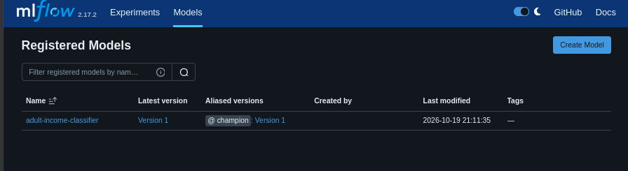
*Figure 12. The Model Registry lists `adult-income-classifier` with alias `@champion` on Version 1.*

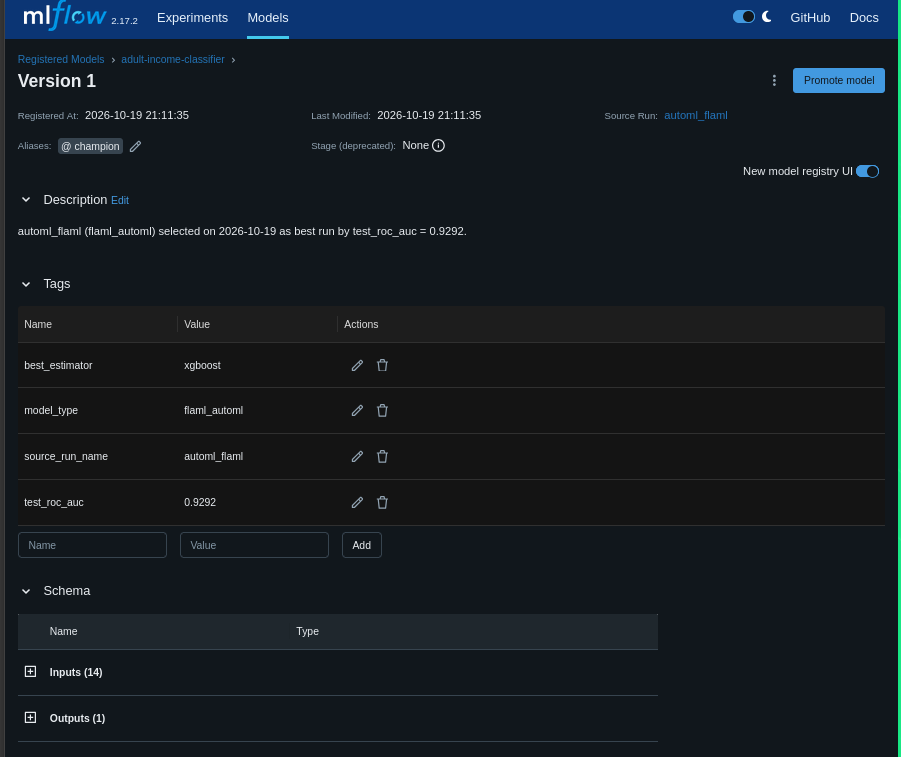
*Figure 13. Version 1: the `@champion` alias, the source run `automl_flaml`, the description, the tags and the 14-input / 1-output schema.*

---

## 9. Explainability with SHAP

`shap_explain.py` loads the champion **from the registry** and explains 1,000 test rows.
- **Method:** SHAP's `TreeExplainer` on the XGBoost model. SHAP values are in **log-odds** of
  `>50K`.
- **Readable names:** one-hot feature names were mapped back to readable labels, e.g.
  `cat__sex_Female` → `sex = Female`.
- **Original values:** plots show unscaled feature values (e.g. age 53, not the standardised 0.75).
- **Tracking:** all figures are also logged to the champion's MLflow run under `shap/`.

### Global explanations

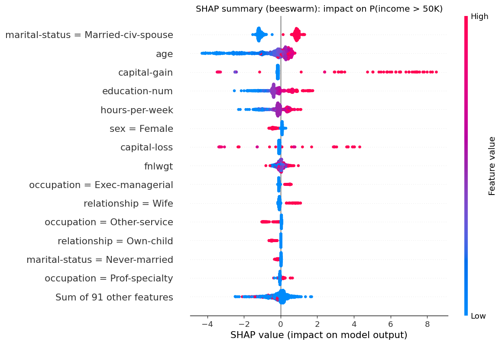
*Figure 14. SHAP summary (beeswarm). Each dot is one person; red = high feature value; right of zero = pushes the prediction toward `>50K`.*

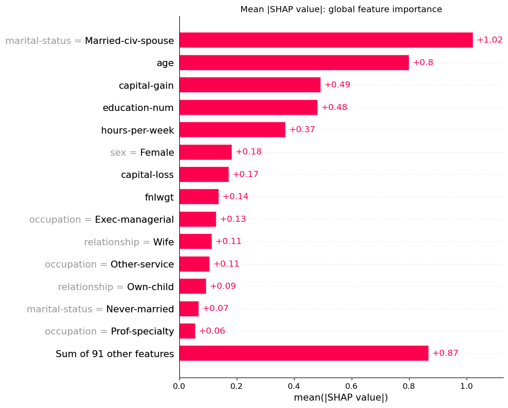
*Figure 15. Global importance: mean |SHAP value| per feature.*

| Rank | Feature | Mean \|SHAP\| | Effect |
|---|---|---|---|
| 1 | marital-status = Married-civ-spouse | 1.02 | Being married raises the predicted probability strongly; not married lowers it. |
| 2 | age | 0.80 | Young age strongly lowers it (down to −4 log-odds); middle age raises it. |
| 3 | capital-gain | 0.49 | Most people have none (small negative effect); large gains push sharply toward `>50K` (up to +8). |
| 4 | education-num | 0.48 | More years of education raise it. |
| 5 | hours-per-week | 0.37 | Longer working hours raise it. |
| 6 | sex = Female | 0.18 | Being female lowers the prediction. |

The model learned patterns that are plausible economically (marriage, age, education, capital
income, hours). It also learned from **sex** (rank 6) and, more weakly, from race (e.g. `race = White` and
`race = Black` rank 21st and 22nd, mean |SHAP| about 0.04). The model
reproduces income gaps that exist in the 1994 census data. That is a fairness concern if such a
model were used for real decisions (see Limitations).

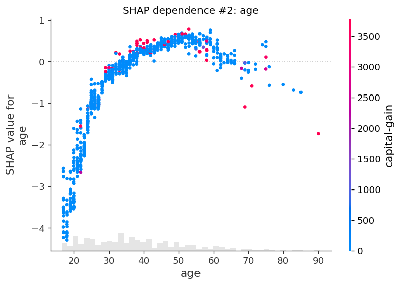
*Figure 16. Dependence plot for age. The effect is strongly negative below about 25, rises steeply, peaks around 45–55, and falls again after 60: an inverted U that a linear model cannot represent. The colour shows the strongest interacting feature.*

### Local explanations

The waterfall plots explain two individual predictions from the test set. Each plot starts at
the model's average output, E[f(X)] = −1.31 log-odds (about 21%), and each bar adds one
feature's contribution until it reaches this person's prediction f(x).

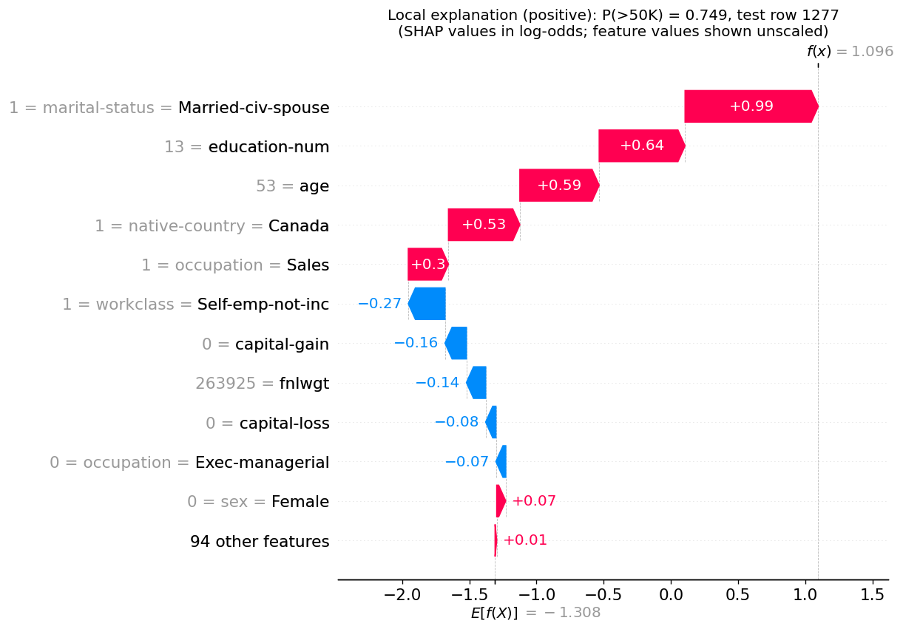
*Figure 17. Predicted `>50K` (test row 1277, P = 0.749).*

**Interpretation (positive case).** This 53-year-old is a married (`Married-civ-spouse`) person
with 13 years of education (bachelor's level), born in Canada, working in sales. The model
predicts a **75%** chance of earning more than \$50K. The biggest pushes upward come from:
- being married (+0.99);
- education (+0.64);
- age 53 (+0.59).

Being self-employed in an unincorporated business (−0.27) and having no capital gain (−0.16)
pull the prediction down, but not enough to change the outcome.

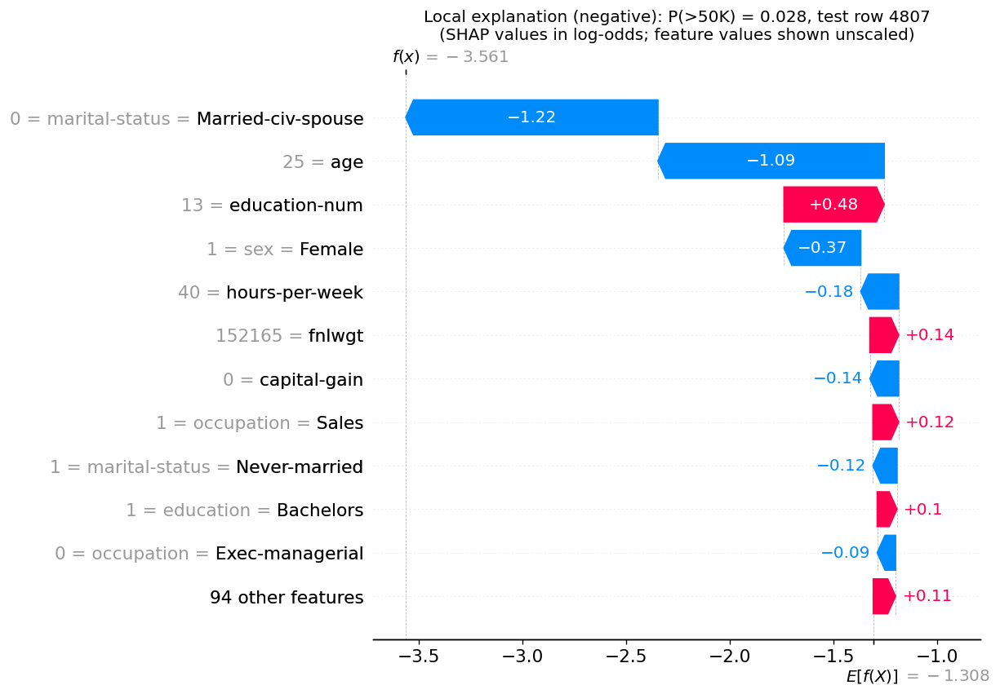
*Figure 18. Predicted `<=50K` (test row 4807, P = 0.028).*

**Interpretation (negative case).** This is a 25-year-old, never-married woman working 40 hours
a week with no capital gain. The model gives her only a **2.8%** chance of earning more than
\$50K. The main reasons are:
- not being married (−1.22);
- young age (−1.09);
- being female (−0.37).

Her bachelor's-level education (education-num 13, +0.48) is the main factor pushing the other
way, but it is outweighed. The example also shows the fairness issue concretely: `sex` directly
lowers her predicted income.

---

## 10. Serving with FastAPI

The champion is served by a **FastAPI** application (`src/serving/app.py`).

- **Startup:** the model is loaded once from the registry (`models:/adult-income-classifier@champion`).
  If loading fails, a `CRITICAL` log is written and the service refuses to start.
- **Input validation:** a Pydantic schema (`PredictionRequest`) checks that every field is
  present and has the right type and a valid range (e.g. `age` 17–120, `hours-per-week` 1–168),
  and rejects unknown fields. Categorical fields may be `null`, which is treated as missing,
  exactly as in training.
- **Traceability:** every response carries a `request_id`, also returned in the
  `X-Request-ID` header and written to the logs.

| Endpoint | Purpose |
|---|---|
| `GET /health` | Liveness, whether the model is loaded, and its registry version |
| `POST /predict` | One prediction: class, label, probability, model version, request id |
| `GET /metrics` | Monitoring snapshot (Section 11) |
| `GET /drift` | Drift check of the live input window against the training reference (Section 12) |

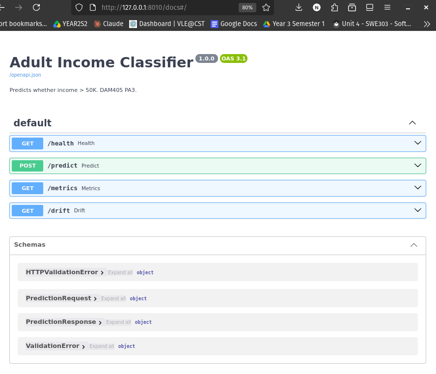
*Figure 19. The auto-generated OpenAPI documentation at `/docs`, listing the four endpoints and the request/response schemas.*

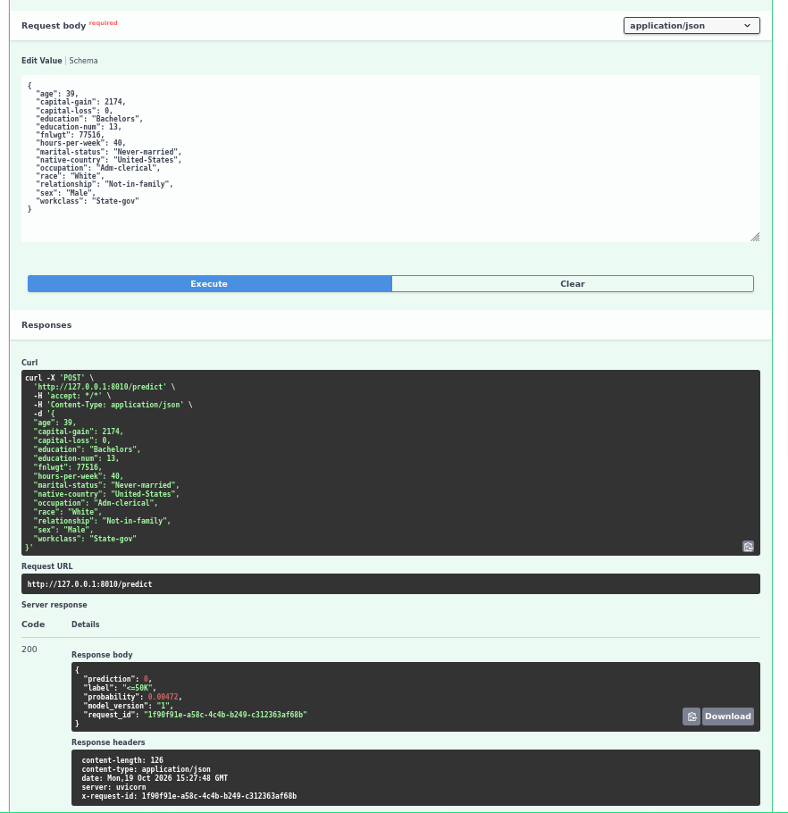
*Figure 20. A valid request returns **200**: `prediction 0` (`<=50K`), probability 0.0047, `model_version "1"` and a `request_id` that matches the `x-request-id` header.*

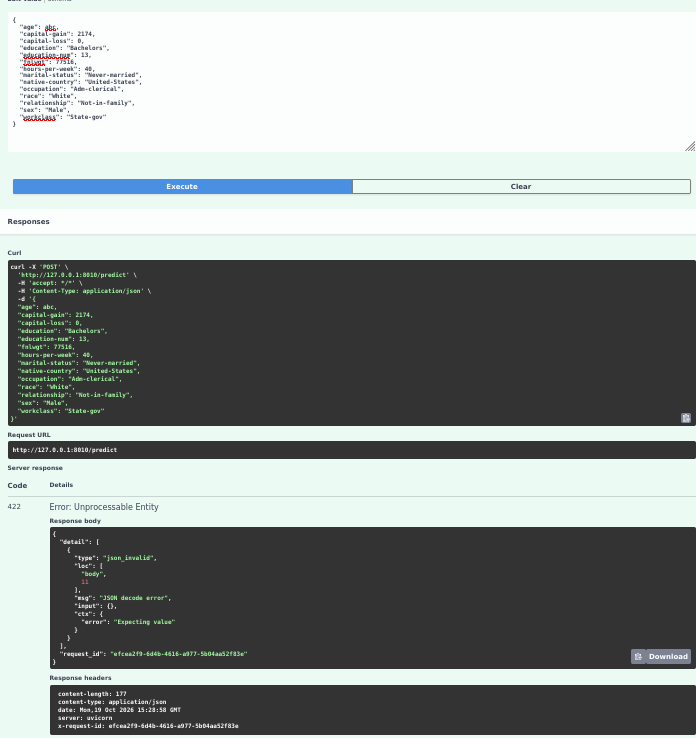
*Figure 21. A malformed request (the value `abc` sent without quotes, so the body isn't valid JSON) is rejected with **422 Unprocessable Entity**. The error body still includes the `request_id`. Wrong types (`"age": "abc"`), missing fields and out-of-range values are also rejected with 422, as covered by the automated tests (Section 13).*

---

## 11. Monitoring and structured logging

### Request monitoring

An HTTP middleware times **every** request and records it in a thread-safe, in-memory
`MetricsStore`. The store tracks:
- request count, error count and error rate;
- latency average, p50, p95, p99 and max;
- predictions per class;
- requests per endpoint and responses per status code;
- uptime.

The snapshot is exposed at `GET /metrics`.

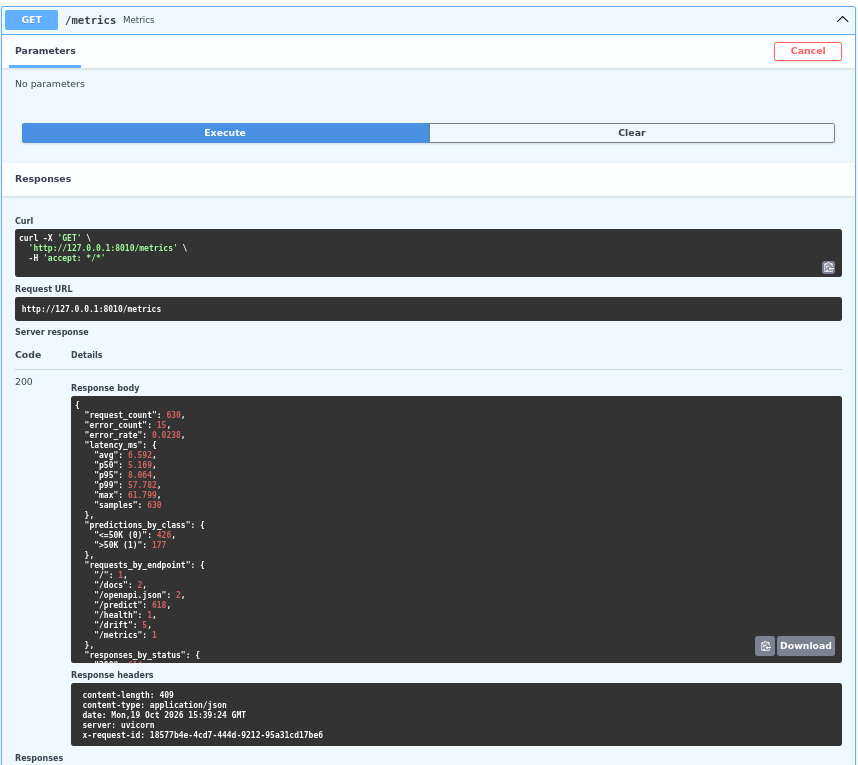
*Figure 22. `/metrics` after the traffic simulation and manual tests.*

| Metric | Value |
|---|---|
| Requests | 630 (618 to `/predict`) |
| Errors | 15 (all 422 invalid inputs: 10 simulated + manual tests) |
| Error rate | 2.4% |
| Latency p50 / p95 / p99 | 5.2 ms / 8.1 ms / 57.8 ms |
| Predictions | 426 × `<=50K`, 177 × `>50K` |

Median latency of about 5 ms shows that loading the model once at startup and caching it works.
The higher p99 reflects a small number of slower requests, such as those that also trigger a
drift check (every 50th prediction once the window is full).

### Structured logging

`src/utils/logging_config.py` configures two handlers for every component:

| Handler | Level | Format | Use |
|---|---|---|---|
| Console | INFO | `time \| LEVEL \| logger \| message` | Read by humans during development |
| Rotating file (`logs/*.log`, 5 MB × 3) | DEBUG | **JSON lines** | Machine-readable evidence; easy to query with `jq` or pandas |

Each JSON record contains `timestamp` (ISO 8601, UTC), `level`, `logger`, `module`, `function`,
`line` and `message`. It also includes request-specific fields: `request_id`, `endpoint`,
`method`, `status_code`, `latency_ms`, and, on errors, the traceback.

Log levels follow a fixed convention:

| Level | Used for |
|---|---|
| INFO | Normal events: request served, model loaded, run finished |
| WARNING | Degraded but working: **drift detected**, invalid input |
| ERROR | A failed request (4xx/5xx), or an unhandled exception with traceback |
| CRITICAL | The service cannot serve (the model failed to load) |

At the end of the session, `logs/service.log` contained **628 INFO, 25 WARNING, 15 ERROR and
0 CRITICAL** records. Examples from the actual file:

```json
{"timestamp": "2026-10-19T15:27:26.866050+00:00", "level": "INFO", "logger": "serving", "module": "app", "function": "observe", "line": 84, "message": "POST /predict -> 200 (13.4 ms)", "request_id": "7626a347-4e1e-4a9d-9bc5-100f8f2590c6", "method": "POST", "endpoint": "/predict", "status_code": 200, "latency_ms": 13.403}
{"timestamp": "2026-10-19T15:26:44.909029+00:00", "level": "WARNING", "logger": "serving", "module": "app", "function": "validation_error", "line": 104, "message": "Invalid request: 1 validation error(s)", "request_id": "80ccdddc-c63e-43e9-b6ac-035d8eda82db", "endpoint": "/predict", "validation_errors": [{"loc": ["body", 11], "msg": "JSON decode error"}]}
{"timestamp": "2026-10-19T15:26:44.909492+00:00", "level": "ERROR", "logger": "serving", "module": "app", "function": "observe", "line": 84, "message": "POST /predict -> 422 (1.1 ms)", "request_id": "80ccdddc-c63e-43e9-b6ac-035d8eda82db", "method": "POST", "endpoint": "/predict", "status_code": 422, "latency_ms": 1.1}
{"timestamp": "2026-10-19T15:34:49.049752+00:00", "level": "WARNING", "logger": "serving", "module": "drift", "function": "check", "line": 153, "message": "Data drift detected in 5 features: age, fnlwgt, capital-gain, hours-per-week, workclass", "event": "drift_detected", "drifted_features": ["age", "fnlwgt", "capital-gain", "hours-per-week", "workclass"], "n_drifted": 5}
```

The WARNING and ERROR records for the rejected request share the same `request_id`
(`80ccdddc…`). One failed request can therefore be traced across log lines, and back to the
client that received that id.

---

## 12. Data-drift detection

### Method

`src/serving/drift.py` keeps a **rolling window of the last 200 live inputs** and compares it
with the training reference snapshot. Once the window is full, it re-checks every 50 requests,
and on demand via `GET /drift`.

| Feature type | Test | Drift if |
|---|---|---|
| Numeric (6) | Two-sample **Kolmogorov–Smirnov** test | p-value < 0.05 |
| Categorical (8) | **Population Stability Index** (PSI) | PSI > 0.2 |
| Overall | Count of drifted features | ≥ 2 features drifted |

**Design decisions:**
- **Requiring at least 2 drifted features.** With 14 features each tested at the 5% level,
  one feature will occasionally be flagged by chance. Requiring two avoids alarms from a single
  random result.
- **Pooling rare categories for PSI.** In the first version, normal traffic was wrongly flagged
  as drifted. `native-country` has about 40 categories, most of them very rare, and in a
  200-row window their shares fluctuate by chance. That inflated PSI.
  - **Fix:** categories under 1% of the training data are pooled into `OTHER` before PSI is
    computed. A brand-new category still lands in `OTHER`, so genuine shifts are still caught.
  - **Effect:** false alarms on 50 random windows of normal test data dropped to **0 of 50**,
    and `native-country` PSI fell to 0.015.

### Unit tests

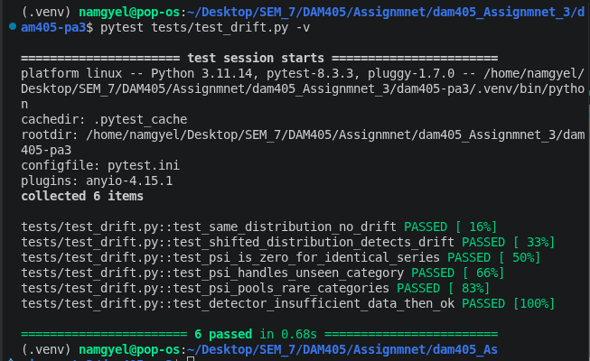
*Figure 23. Six drift unit tests pass. They check that same-distribution data gives no drift, shifted data gives drift, PSI of identical series is 0, an unseen category is caught, rare-category pooling reduces noise, and the detector reports `insufficient_data` until its window is full.*

### Live drift: simulated traffic

`scripts/simulate_traffic.py` sent three phases of traffic to the running API:

1. **300 normal requests**, sampled from the test set.
2. **300 drifted requests:** age +15 years (capped at 90), hours-per-week ×1.5 (capped at 99),
   40% of rows given a capital gain of 5,000–20,000, 70% of `workclass` set to `Self-emp-inc`,
   and `marital-status` re-sampled to 70% `Never-married`.
3. **10 malformed requests**, which produced the 422 errors above.

| After phase | `drift_detected` | Drifted features |
|---|---|---|
| Normal traffic | **False** | 1 (`age`, a chance result, below the 2-feature threshold) |
| Drifted traffic | **True** | 5: `age`, `capital-gain`, `hours-per-week`, `workclass`, `marital-status` |

The five features flagged after phase 2 are exactly the five that were shifted. When drift was
detected, the service logged a **WARNING** each time it re-checked (Section 11) and kept serving
predictions. This is the intended "degraded but working" behaviour.

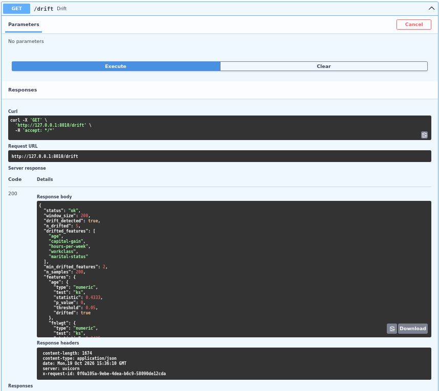
*Figure 24. `GET /drift` after the drifted traffic: `drift_detected: true`, 5 drifted features, and per-feature details (e.g. age: KS statistic 0.433, p ≈ 0).*

### Offline drift report

The same KS/PSI logic can be run offline on a batch file. This is how a day of production
inputs would be audited. Running it on the 300 drifted rows:

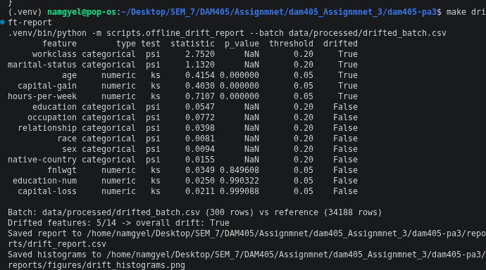
*Figure 25. Per-feature drift table for the drifted batch (300 rows) vs the reference (34,188 rows): 5/14 features drifted, so overall drift = True.*

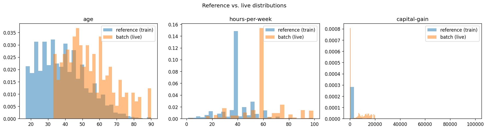
*Figure 26. Reference (training) vs live distributions. Age shifts right, hours-per-week jumps from a peak at 40 to a peak at 60, and many more people have capital gains of 5,000–20,000.*

The strongest signals are the categorical shifts: `workclass` (PSI 2.75) and `marital-status`
(PSI 1.13), both far above the 0.2 threshold. Unshifted features stay well within limits: for
example, `capital-loss` has p = 0.999 and `race` has PSI 0.008. This shows the detector is
specific to real changes.

---

## 13. Testing

The test suite has **17 tests**, all passing:

| File | Tests | What is checked |
|---|---|---|
| `tests/test_logging.py` | 3 | JSON-lines output with `extra` fields; exception tracebacks are captured; no duplicate handlers |
| `tests/test_drift.py` | 6 | KS/PSI behaviour, rare-category pooling, detector window logic |
| `tests/test_api.py` | 8 | `/health`; valid `/predict`; null categories accepted; missing field, wrong type and out-of-range all return 422; `/metrics` counts requests and errors; `/drift` before the window is full |

The API tests inject a fake model, so they run in about 1 second without MLflow and don't write
to the real log files.

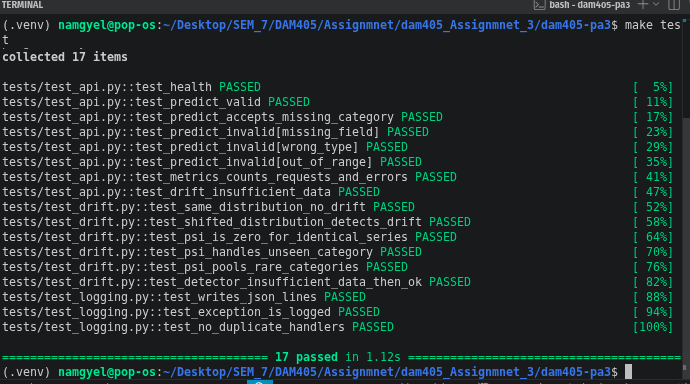
*Figure 27. `make test`: 17 passed in 1.12 s.*

---

## 14. How to run

Requires Python 3.11 and [uv](https://docs.astral.sh/uv/). A detailed walkthrough with expected
outputs is in [docs/RUNBOOK.md](docs/RUNBOOK.md).

```bash
make setup                 # create .venv and install pinned requirements
source .venv/bin/activate

make data                  # download, clean, split, save drift reference
make baseline              # Logistic Regression -> MLflow
make automl                # FLAML search (180 s) -> MLflow
make register              # best run -> adult-income-classifier@champion
make explain               # SHAP figures -> reports/figures + MLflow

make mlflow-ui             # (separate terminal) http://127.0.0.1:5000
make serve                 # (separate terminal) http://127.0.0.1:8010/docs
make simulate              # normal, drifted and malformed traffic
make drift-report          # offline drift table + histograms
make test                  # 17 tests
```

The API runs on port **8010** because 8000 was already used by another service on the
development machine. Change `serving.port` in `config/config.yaml` to use a different port.

Example request:

```bash
curl -X POST http://127.0.0.1:8010/predict -H "Content-Type: application/json" -d '{
  "age": 39, "workclass": "State-gov", "fnlwgt": 77516, "education": "Bachelors",
  "education-num": 13, "marital-status": "Never-married", "occupation": "Adm-clerical",
  "relationship": "Not-in-family", "race": "White", "sex": "Male", "capital-gain": 2174,
  "capital-loss": 0, "hours-per-week": 40, "native-country": "United-States"}'
```

---

## 15. Project structure

```
dam405-pa3/
├── config/config.yaml              single source of all settings
├── data/
│   ├── raw/                        adult.csv (cached download)
│   ├── processed/                  train/val/test parquet, drifted_batch.csv
│   └── reference/                  reference.parquet (drift baseline)
├── docs/
│   ├── architecture.md             Mermaid architecture diagram
│   └── RUNBOOK.md                  step-by-step run guide
├── logs/                           training.log, service.log, flaml.log (JSON lines)
├── reports/
│   ├── figures/                    evaluation, SHAP and drift plots
│   ├── images/                     screenshots used in this report
│   ├── drift_report.csv, flaml_search_history.csv, shap_feature_importance.csv
├── scripts/
│   ├── simulate_traffic.py         normal / drifted / malformed traffic
│   └── offline_drift_report.py     batch drift report
├── src/
│   ├── config.py                   config loading, path resolution
│   ├── utils/logging_config.py     console + JSON-lines logging
│   ├── data/                       load_data.py, preprocess.py
│   ├── training/                   evaluate.py, train_baseline.py, train_automl.py, register_model.py
│   ├── explain/shap_explain.py
│   └── serving/                    app.py, schemas.py, model_loader.py, monitoring.py, drift.py
├── tests/                          test_logging.py, test_drift.py, test_api.py
├── Makefile, requirements.txt, pytest.ini
└── mlflow.db, mlartifacts/         MLflow store (not committed)
```

---

## 16. Limitations and future work

- **In-memory monitoring.** `/metrics` counters and the drift window live inside the process.
  They reset on restart and are not shared between multiple workers. A production system
  would export them to Prometheus and Grafana.
- **Drift is not performance.** The service detects *input* drift but receives no ground-truth
  labels, so it cannot tell whether accuracy actually dropped. Delayed labels would be needed to
  monitor performance.
- **Fixed 0.5 decision threshold.** Recall for `>50K` (0.64) is well below precision (0.79). The
  threshold could be tuned on the validation set for the business goal, e.g. to maximise F1.
- **Fairness not assessed.** `sex` and `race` are used as features, and SHAP shows that being
  female directly lowers predictions. Before any real use, fairness metrics should be computed,
  e.g. demographic parity or equal opportunity across groups, and sensitive attributes
  reconsidered.
- **Older xgboost for portability.** xgboost is pinned to 1.7.6 (CPU-only) to keep installs
  light and reproducible. That gives up newer features (GPU training, native categorical
  handling), and numpy and scikit-learn are held back with it.
- **AutoML is time-budgeted.** FLAML's result depends on the 180 s budget and on machine speed,
  so a re-run may pick a slightly different model. Only one AutoML run was compared.
- **Dataset age.** The data comes from the 1994 US census. Patterns (and the \$50K threshold)
  don't reflect today's incomes, so the model is a teaching example, not a deployable system.
- **Drift simulation.** The drift was synthetic and deliberately strong. Subtle, gradual
  real-world drift would be harder to detect with a 200-row window.

---

## 17. References

- Becker, B., & Kohavi, R. (1996). *Adult* [Dataset]. UCI Machine Learning Repository. https://doi.org/10.24432/C5XW20
- Wang, C., Wu, Q., Weimer, M., & Zhu, E. (2021). FLAML: A fast and lightweight AutoML library. *Proceedings of Machine Learning and Systems (MLSys)*, 3.
- Lundberg, S. M., & Lee, S.-I. (2017). A unified approach to interpreting model predictions. *Advances in Neural Information Processing Systems (NeurIPS)*, 30.
- Lundberg, S. M., et al. (2020). From local explanations to global understanding with explainable AI for trees. *Nature Machine Intelligence*, 2, 56–67.
- Chen, T., & Guestrin, C. (2016). XGBoost: A scalable tree boosting system. *Proceedings of KDD 2016*.
- Pedregosa, F., et al. (2011). Scikit-learn: Machine learning in Python. *Journal of Machine Learning Research*, 12, 2825–2830.
- MLflow documentation (v2.17): https://mlflow.org/docs/latest/
- FastAPI documentation: https://fastapi.tiangolo.com/
- Siddiqi, N. (2006). *Credit Risk Scorecards*. Wiley. (Population Stability Index)

---

## 18. AI-use declaration

This project was developed with the assistance of **Claude Code** (Anthropic), an AI coding
assistant.

**Claude Code:**
- **Scaffolded the project:** directory structure, `requirements.txt`, `Makefile`,
  `config.yaml`, logging configuration and data loader.
- **Wrote the implementation:** the preprocessing, training, AutoML, registry, SHAP, serving,
  monitoring, drift-detection, simulation and test code.
- **Diagnosed and fixed environment issues:** the xgboost / numpy / scikit-learn / SQLAlchemy
  pins and the port conflict.
- **Fixed problems found during testing:** missing-value handling for `None`, rare-category
  pooling in PSI, and readable SHAP plots.
- **Produced a step-by-step runbook** and drafted this README from my results and screenshots.

**I:**
- set the assignment requirements and specification for the project;
- ran every stage of the pipeline myself and took all the screenshots used as evidence;
- checked the outputs against expectations;
- reviewed the code, the explanations and this report.

_&lt;Edit this section so it accurately describes your own contribution before submitting.&gt;_
