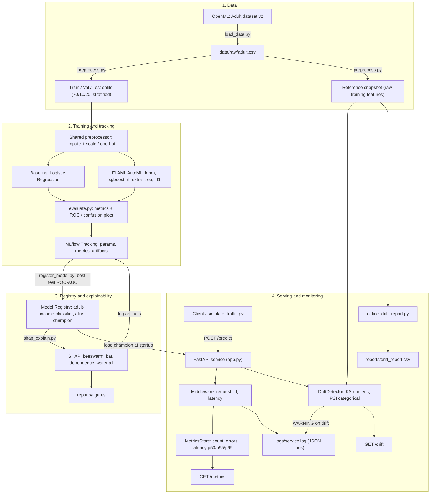

# Architecture

End-to-end workflow, from raw data to a monitored, explainable prediction service.
All settings come from `config/config.yaml`.

## Components

| Stage | Module | Output |
|---|---|---|
| Ingest | `src/data/load_data.py` | `data/raw/adult.csv` |
| Split + reference | `src/data/preprocess.py` | `data/processed/*.parquet`, `data/reference/reference.parquet` |
| Baseline | `src/training/train_baseline.py` | MLflow run `baseline_logreg` |
| AutoML | `src/training/train_automl.py` | MLflow run `automl_flaml` (+ search history CSV) |
| Registry | `src/training/register_model.py` | `adult-income-classifier@champion` |
| Explain | `src/explain/shap_explain.py` | `reports/figures/*.png`, artifacts on champion run |
| Serve | `src/serving/app.py` | `/health`, `/predict`, `/metrics`, `/drift` |
| Monitor | `src/serving/monitoring.py`, `drift.py` | `logs/service.log`, endpoint JSON |
